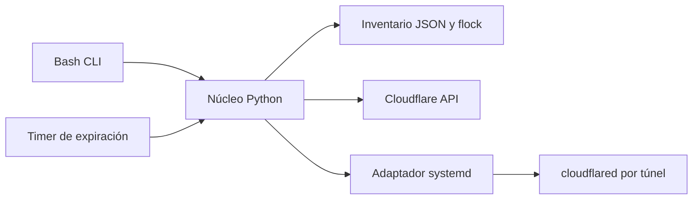

# Diseño de Classic

El Hito 0 se apoya en la [guía oficial de Tunnel](https://developers.cloudflare.com/tunnel/get-started/), la [referencia de tokens](https://developers.cloudflare.com/tunnel/reference/tunnel-tokens/) y la [API de túneles](https://developers.cloudflare.com/api/resources/zero_trust/subresources/tunnels/). Usamos Named Tunnels administrados remotamente, con ingress HTTP(S) explícito, un catch-all 404 y un CNAME proxied. La cuenta y la zona se fijan en la configuración. La validación de certificados se mantiene activa. Para certificados de varios niveles y otros requisitos de publicación, revisar la [guía de publicación por API](https://developers.cloudflare.com/cloudflare-one/networks/connectors/cloudflare-tunnel/get-started/create-remote-tunnel-api/) antes de aprovisionar.

JSON con la biblioteca estándar de Python permite validar URLs, transmitir JSON por HTTPS y persistir un registro privado por túnel. Un flock serializa cambios locales. Cada reemplazo pasa por fsync, rename y fsync del directorio. SQLite sería útil con consultas agregadas o escritores distribuidos. Python evita combinar varios programas para controlar errores y escrituras. Bash sigue siendo el punto de entrada.

El ID interno identifica servicio, credencial y marcador DNS. El registro versionado conserva cuenta, zona, UUID remoto, hostname, DNS, origen, estado y expiración. `protection.mode=classic` reserva un punto de integración. La CLI y el adaptador están separados del transporte. Para Termux queda evaluar supervisión sin root, Termux:Boot y las restricciones de ejecución de Android. El adaptador entregado requiere systemd.

El orden de implementación es inventario y validación, creación recuperable, ciclo local y caducidad, eliminación e inspección, instalación y pruebas con dobles. Las pruebas ejercitan transiciones tras interrupción, conflictos de propiedad, ejecución y expiración. Los tokens salen de ficheros privados y la API solo recibe el token administrativo mediante HTTPS. El conector se ejecuta con un usuario dinámico y recibe su token mediante una credencial systemd.

Guard queda para el Hito 2. Las reglas personalizadas de zona están disponibles en todos los planes con cuotas distintas. Los rulesets personalizados a nivel de cuenta requieren Enterprise y las cuotas de listas dependen del plan. El siguiente diseño debe verificar cuotas, propagación y expiración antes de seleccionar el mecanismo. [Reglas WAF](https://developers.cloudflare.com/waf/custom-rules/) · [Listas](https://developers.cloudflare.com/waf/tools/lists/)

## Siguiente hito

Para Guard, empezar con un Worker y un diseño de bloqueo por hostname que preserve Access y la autenticación del origen. Comparar reglas WAF con listas de IP y una opción de autorización evaluada por solicitud. La decisión depende de cómo se hace efectiva la caducidad si el Worker o la reconciliación fallan. Evaluar D1 y Durable Objects con dos sesiones de la misma IP, revocación independiente y pruebas de concurrencia. Aprobar el diseño y los límites del plan antes de desplegarlo.
